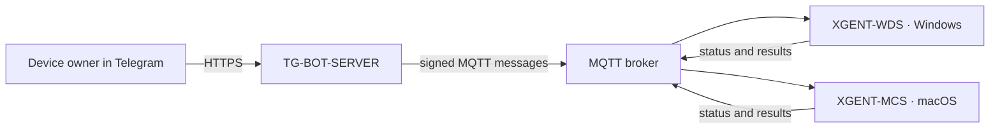

# XIDER · TARPED

[English](README.md) · [Русский](README.ru.md)

## Purpose

XIDER is source code for managing owner-authorized Windows and macOS devices
through Telegram. The bot checks access and routes a command over MQTT; an
agent on the selected device performs it and returns a result. Repository
version 4.3.6 identifies source metadata, not proof that a package is published
or installed.

## Architecture



## Components

- **TG-BOT-SERVER** provides the Telegram interface, role checks, device
  controls, and release catalog.
- **XGENT-WDS** and **XGENT-MCS** are the Windows and macOS endpoint agents.
- **Guard Keeper** reports supervisor state and can recover its agent according
  to local configuration. It cannot make an offline or powered-off computer
  available.
- **X-LEDGER** lists GitHub releases; **X-DOCK** handles the signed agent update
  flow. **X-LEX** offers six interface voices: X-TECH, X-PERSON, X-PIKMI,
  X-TARPED, X-CORE, and X-ADAM. X-LEX changes wording, not permissions or
  command behavior.

## OS support

The repository contains Windows (`XGENT-WDS`) and macOS (`XGENT-MCS`) agent
paths. Their source and offline fixtures do not establish acceptance on every
OS release or physical device. Check the [release notes](CHANGELOG.md) for the
scope of changes and the [TARPED acceptance checklist](docs/TARPED.md) for
remaining work.

## Install, update and rollback

For a source checkout, use Python 3.11 or newer. Docker and Docker Compose are
needed only for the included MQTT broker. A `docker compose up -d` command alone
does not configure the broker: create its TLS certificates and password, open
the TLS listener, and follow the steps in [broker/README.md](broker/README.md)
before starting it.

```sh
cp TG-BOT-SERVER/.env.example TG-BOT-SERVER/.env
cp XGENT-WDS/.env.example XGENT-WDS/.env
cp XGENT-MCS/.env.example XGENT-MCS/.env
```

Before launching anything, configure the bot and both agents with the same
`SHARED_KEY`, `MQTT_BROKER`,
`MQTT_PORT=8883`, `MQTT_TLS=true`, broker `MQTT_USERNAME` and `MQTT_PASSWORD`,
and `ENCRYPT_PAYLOAD=true` in all three `.env` files. The bot also needs its
`BOT_TOKEN` and `ADMIN_ID`. Keep these files out of Git. Then start the
configured broker with `docker compose up -d` from `broker/`. After configuring
the bot's `.env`, install and launch it with:

```sh
cd TG-BOT-SERVER
python -m pip install -r requirements.txt
python bot.py --serve
```

Use the [deployment instructions](deploy/README.md) for the platform agent
install steps.

The Windows installer registers visible per-user Scheduled Tasks named
`XIDER Agent` and `XIDER Guardian`, and grants the current Windows account read
access to `.env`. It disables inherited ACL entries; pre-existing explicit ACL
entries may remain. The macOS bootstrap prepares a source
checkout and Python runtime, registers per-user LaunchAgents for the agent and
Guardian, and preserves the local `.env` and previous checkout for rollback.
These are installer side effects; successful live/device acceptance is not
implied.

Installable packages, when available, are listed in [GitHub Releases](https://github.com/invinby/XIDER/releases).
That release-notes address is distinct from the repository homepage and from
the GitHub Pages installer endpoint; this README does not claim that Pages
installers are published. Agent updates use a selected release tag, owner
confirmation, a pinned publisher key, and signed-package checks. The supported
transactional path keeps a prior version and attempts rollback if activation
fails. See [deployment instructions](deploy/README.md) before deployment.

## Permissions and security

The protected owner is identified by configuration. Other accounts have user,
guest, or blocked state; user access is scoped by device and action grants.
Device actions require the corresponding grant and, where applicable, local OS
permission. MQTT uses TLS and messages are HMAC-signed. Payload encryption is
controlled by `ENCRYPT_PAYLOAD`; do not assume it is active in every local
configuration. The Windows scheduled-task installer requires TLS and
encrypted-payload settings before it changes the task. Read [SECURITY.md](SECURITY.md) for
the source-backed details and safe handling guidance.

## Diagnostics

Run the local component suites with `python tools/run_tests.py`. The fixtures
use offline test settings and do not connect to Telegram, MQTT, or a VPS. GitHub
CI checks source and installer fixtures; those checks do not replace live
service or device acceptance. Live/device acceptance remains unverified.

## Limitations

An online indicator reflects a recent heartbeat, not guaranteed availability.
IP-based location is approximate, not GPS. Camera, microphone, screen capture,
and other protected capabilities require an authorized command and applicable
OS permission. A command submission alone does not prove that a physical
device completed the action.

## Status

The current source version is 4.3.6. Check [GitHub Releases](https://github.com/invinby/XIDER/releases)
for published packages and release-specific evidence. Live Windows/macOS,
Telegram, MQTT, and production VPS acceptance must be recorded separately; it
is not implied by source tests or this README.

## License

XIDER is licensed under MIT; see [LICENSE](LICENSE). Use it only on devices you
own or are explicitly authorized to manage.
