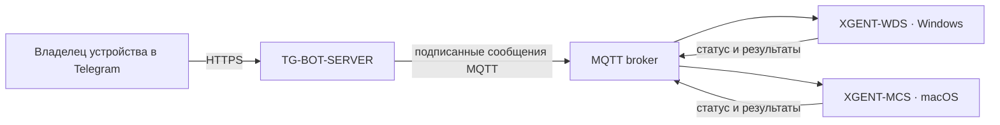

# XIDER · TARPED

[English](README.md) · [Русский](README.ru.md)

## Назначение

XIDER — исходный код системы управления устройствами Windows и macOS, на
которые у владельца есть разрешение. Бот проверяет доступ и передаёт команду
через MQTT; её выполняет агент на выбранном устройстве и возвращает результат.
Версия исходников 4.3.8 не доказывает, что пакет опубликован или установлен.

## Архитектура



## Компоненты

- **TG-BOT-SERVER** предоставляет интерфейс Telegram, проверку ролей,
  управление устройствами и каталог релизов.
- **XGENT-WDS** и **XGENT-MCS** — агенты для Windows и macOS.
- **Guard Keeper** сообщает состояние supervisor и может восстановить агент
  согласно локальной настройке. Он не сделает доступным выключенный компьютер
  или устройство без сети.
- **X-LEDGER** показывает GitHub Releases; **X-DOCK** выполняет сценарий
  подписанного обновления агента. В **X-LEX** есть шесть голосов интерфейса:
  X-TECH, X-PERSON, X-PIKMI, X-TARPED, X-CORE и X-ADAM. X-LEX меняет текст, но
  не права доступа и не действие команды.

## Поддержка ОС

В репозитории есть агентские сценарии для Windows (`XGENT-WDS`) и macOS
(`XGENT-MCS`). Исходники и офлайн-фикстуры не подтверждают приёмку на каждой
версии ОС или физическом устройстве. Смотри [историю релизов](CHANGELOG.md),
чтобы понять объём изменений, и [чек-лист TARPED](docs/TARPED.md), где отмечена
оставшаяся работа.

## Установка, обновление и откат

Для работы с исходниками нужен Python 3.11 или новее. Docker и Docker Compose
нужны только для MQTT-брокера из репозитория. Одной команды `docker compose up -d`
недостаточно: брокеру нужны TLS-сертификаты, пароль и открытый TLS-порт.
Сначала выполни шаги из [broker/README.md](broker/README.md).

```sh
cp TG-BOT-SERVER/.env.example TG-BOT-SERVER/.env
cp XGENT-WDS/.env.example XGENT-WDS/.env
cp XGENT-MCS/.env.example XGENT-MCS/.env
```

До запуска настрой бота и оба агента на одинаковый `SHARED_KEY`, `MQTT_BROKER`,
`MQTT_PORT=8883`, `MQTT_TLS=true`, broker `MQTT_USERNAME` и `MQTT_PASSWORD`,
а также `ENCRYPT_PAYLOAD=true` во всех трёх `.env`. Боту дополнительно нужны
`BOT_TOKEN` и `ADMIN_ID`. Не добавляй `.env` в Git. После настройки запусти
брокер командой `docker compose up -d` из `broker/`. Для установки и запуска
бота после настройки его `.env` выполни:

```sh
cd TG-BOT-SERVER
python -m pip install -r requirements.txt
python bot.py --serve
```

Инструкции по установке агента на каждой платформе смотри в
[руководстве по развёртыванию](deploy/README.md).

Установщик Windows регистрирует видимые задачи Scheduled Tasks для текущего
пользователя с именами `XIDER Agent` и `XIDER Guardian` и выдаёт текущей
учётной записи Windows право чтения файла `.env`. Он отключает наследуемые
записи ACL; ранее заданные явные записи ACL могут сохраниться.
Bootstrap macOS подготавливает checkout исходников и Python runtime, регистрирует
пользовательские LaunchAgents агента и Guardian, сохраняет локальный `.env` и
предыдущий checkout для отката. Это описание действий установщиков, а не
подтверждение успешной проверки на реальных сервисах или устройствах.

Если установочные пакеты опубликованы, они перечислены в [GitHub Releases](https://github.com/invinby/XIDER/releases).
Эта страница заметок о релизах не является ни главной страницей репозитория,
ни установочным endpoint на GitHub Pages; README не утверждает, что Pages-
установщики опубликованы. Для обновления агента выбирается тег релиза, владелец
подтверждает действие, а пакет проверяется закреплённым ключом издателя и
подписью. Поддерживаемый транзакционный сценарий сохраняет предыдущую версию
и пытается откатить её при неудачной активации. Перед развёртыванием изучи
[инструкции](deploy/README.md).

## Разрешения и безопасность

Защищённый владелец определяется конфигурацией. Для остальных аккаунтов
используются роли пользователя, гостя или заблокированного; доступ пользователя
ограничивается выданными правами на устройство и действие. Команда требует
соответствующего права и, когда применимо, разрешения локальной ОС. MQTT
работает через TLS, сообщения подписываются HMAC. Шифрование содержимого
управляется параметром `ENCRYPT_PAYLOAD`; не считай его включённым в любой
локальной конфигурации. Windows-установщик, который меняет Scheduled Task,
требует TLS и включённое шифрование содержимого. Подробности по
исходникам и безопасной работе — в [SECURITY.md](SECURITY.md).

## Диагностика

Локальные наборы компонент запускаются командой `python tools/run_tests.py`.
Фикстуры используют офлайн-настройки и не подключаются к Telegram, MQTT или
VPS. GitHub CI проверяет исходники и фикстуры установщиков; это не заменяет
проверку действующих сервисов или устройств.

## Ограничения

Статус «онлайн» означает, что недавно пришёл heartbeat, но не гарантирует
доступность устройства. Геолокация по IP приблизительна и не является GPS.
Камера, микрофон, запись экрана и другие защищённые возможности требуют
разрешённой команды и соответствующего разрешения ОС. Отправка команды сама
по себе не подтверждает, что физическое устройство её выполнило.

## Статус

Текущая версия исходников — 4.3.8. Смотри [GitHub Releases](https://github.com/invinby/XIDER/releases),
чтобы найти опубликованные пакеты и подтверждения для конкретного релиза.
Приёмку на Windows/macOS, в Telegram, MQTT и на production VPS нужно
фиксировать отдельно: исходные тесты и этот README её не подтверждают.
Приёмка физических устройств пока не подтверждена.

## Лицензия

XIDER распространяется по лицензии MIT; см. [LICENSE](LICENSE). Используй
систему только на своих устройствах или с явного разрешения их владельца.
